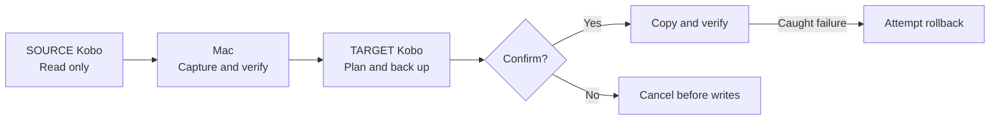

<h1 align="center">📚 KOReader Bridge</h1>

<p align="center">
  <strong>Bring your reading setup to your next device.</strong><br/>
  An independent, MIT-licensed open-source Python CLI for migrating KOReader, supported ebooks, reading data and fonts.<br/>
  Currently supports Kobo → Kobo migration on macOS.<br/>
  Keep the original folder paths, preview changes and verify copied files.
</p>

<p align="center">
  <a href="https://github.com/gh-slee/koreader-bridge/actions/workflows/tests.yml?query=branch%3Amain"></a>
  <a href="#tech-stack"></a>
  <a href="#requirements"></a>
  <a href="#tech-stack"></a>
  <a href="LICENSE"></a>
  <a href="#project-status-and-roadmap"></a>
</p>

<p align="center">
  <a href="#quick-start">Quick start</a> ·
  <a href="#choose-a-mode">Modes</a> ·
  <a href="#device-support">Device support</a> ·
  <a href="#tech-stack">Tech stack</a> ·
  <a href="#language-support">Languages</a> ·
  <a href="#contributing">Contribute</a> ·
  <a href="https://github.com/gh-slee/koreader-bridge/issues">Report a bug</a>
</p>

> [!IMPORTANT]
> **This source snapshot is `1.0.0-rc.2`, a release candidate, not a stable release.** [1.0.0-rc.1](https://github.com/gh-slee/koreader-bridge/releases/tag/v1.0.0-rc.1) was published on 2026-10-21. Download the pinned package below, or consult the [release list](https://github.com/gh-slee/koreader-bridge/releases) for later published candidates; a source version alone does not mean its assets have been published. KOREADER file verification, startup and basic reading have scoped device confirmation; broader acceptance remains pending. Device migration requires **macOS**. See the [version transition](#versioning) and [stable-release gates](ACCEPTANCE.md#first-stable-release-gates).

## Why use it?

| | What you get |
| --- | --- |
| 📦 **Four migration modes** | Copy the entire supported setup, only KOReader, selected library content, or inspect without device writes. |
| 📂 **Original book locations** | `Books/Comics/issue.cbz` on SOURCE stays `Books/Comics/issue.cbz` on TARGET. EPUB, PDF, CBZ and other recognised formats follow the same rule. |
| 🔎 **A plan before changes** | Preview new, changed, identical and TARGET-only files. Size/SHA-256 comparisons skip identical payload files. |
| 🛟 **Backups and recovery** | Capture SOURCE, back up TARGET, verify copied bytes and attempt rollback on caught failures. Reuse saved SOURCE archives or restore a recorded TARGET snapshot. |
| 🧭 **Visible progress** | Phase timestamps, file/byte counts, transfer/hash speed, ETA and archive heartbeats show what the tool is doing. |
| 🔒 **Offline operation** | Python standard library plus macOS tools. No runtime downloads, telemetry, AI keys or LLM service. Private artifacts stay in local run folders. |

## Device support

**Kobo → Kobo is the only currently supported device migration direction.** KOReader Bridge is the new project name; support for additional KOReader devices is future work. The name does not imply compatibility with every device that runs KOReader.

| Device migration | Status | Host and limits |
| --- | --- | --- |
| Kobo → Kobo | Implemented; broader manual acceptance pending | macOS, Python 3.9+. Confirm device roles and SOURCE build compatibility; no claim of universal Kobo model/plugin certification. |
| Routes involving Kindle | Planned research; unsupported | No Kindle detection, adapter or validated transfer policy is implemented. |
| Other KOReader device families | Future scope; unsupported | Platform selection, compatibility rules and validation are still to be defined. |

Additional device support is outside the first `1.0.0` milestone. Each new platform needs its own migration policy and tests before appearing as supported. See the [device-support roadmap](TRACKER.md#device-support-roadmap).

Current source uses **`koreader-bridge.py`**. Keep the adjacent `kobo-koreader-migrate.py` shared engine and the complete `locales/` directory; the old script remains a compatible command. Both entries use the same run root, locks and migration safeguards. Published RC1/3.x packages predate the new entry, so their pinned commands below still use the old filename. New source packages use `koreader-bridge-VERSION.zip`; historical packages retain their original names and bytes.

## Quick start

The version-pinned [1.0.0-rc.1 pre-release](https://github.com/gh-slee/koreader-bridge/releases/tag/v1.0.0-rc.1) is available for controlled testing. These download commands deliberately select that published package; a clone or another source archive may contain a different version. Start with the offline checks and a dry run.

### 1. Get the project

For the version-pinned package, download `kobo-koreader-migrate-1.0.0-rc.1.zip` and `SHA256SUMS` from the linked pre-release page into the same folder:

```bash
shasum -a 256 -c SHA256SUMS
unzip kobo-koreader-migrate-1.0.0-rc.1.zip
cd kobo-koreader-migrate-1.0.0-rc.1
python3 kobo-koreader-migrate.py --version
python3 scripts/check_locales.py
python3 kobo-koreader-migrate.py --self-test
```

Alternatively, clone the development source on `main`; use `--version` to identify the checked-out build:

```bash
git clone https://github.com/gh-slee/koreader-bridge.git
cd koreader-bridge
python3 --version
python3 koreader-bridge.py --version
python3 scripts/check_locales.py
python3 koreader-bridge.py --self-test
```

Python 3.9+ is required. No `pip install` is needed. You can also select `main` on GitHub and choose **Code > Download ZIP**. For current source, keep both Python entry/engine files and the complete `locales/` directory together; copying a single script is not a complete installation, even for English. In older published packages, use `kobo-koreader-migrate.py` with their original contents.

### 2. Explore without a Kobo

```bash
python3 koreader-bridge.py --help
python3 koreader-bridge.py --list-locales
python3 koreader-bridge.py --locale zh-Hant --preview-ui
```

These help/list/preview commands do not inspect devices or existing run data and do not create migration logs/backups. The UI preview is a static sample, separate from device inspection with `--dry-run`.

### 3. Preview a migration

Disconnect both Kobos first. Quit KOReader normally before connecting either device, then follow the SOURCE/TARGET prompts one device at a time:

```bash
python3 koreader-bridge.py --mode full --dry-run
```

A dry run reads both devices and creates local reports/locks, but changes no Kobo files and creates no ZIP backups. Review the plan. When ready to migrate, rerun without `--dry-run`; the tool recalculates the plan and asks for final confirmation:

```bash
python3 koreader-bridge.py --mode full
```

> [!NOTE]
> FULL includes supported books, reading data and root fonts by default. It retains TARGET-only library files outside `.adds/koreader`, but replaces the **entire KOReader directory** after backup. See [complete mode behavior](docs/USAGE.md#choose-a-mode) before approving writes.

Do not run as `sudo`. Keep backups until you have checked the result on TARGET. Cloning main obtains current development source, not a version-pinned release. Publishing the pre-release does not complete physical-device acceptance. SHA-256 checks detect mismatches; the checksum file is not a digital signature.

## Requirements

- **macOS** with `ditto`, `diskutil` and `sync`; **Python 3.9+**. No third-party Python packages.
- Kobo USB storage, connected **one device at a time**, with readable `.kobo/version` identity data.
- Existing SOURCE KOReader installation for FULL/KOREADER and enough Mac/TARGET space for staging, backups and copying.
- The operator confirms each physical model and SOURCE-build compatibility with TARGET.

[Full compatibility requirements](docs/USAGE.md#requirements-and-compatibility). Windows/Linux device migration is unsupported; Linux CI validates fixtures only.

## Choose a mode

| Mode | KOReader runtime | Books and reading data outside runtime | Root fonts |
| --- | --- | --- | --- |
| **FULL** | Replace entire tree | Included, preserving original paths | Included by default |
| **KOREADER** | Replace entire tree | Not copied | Not copied |
| **LIBRARY** | Retain installed runtime | Selected with flags/prompts | Optional |
| **AUDIT** | Inspect and plan only | Inspect selected content | Inspect if selected |

FULL is the default interactive mode. It retains TARGET-only library files outside `.adds/koreader`, but replaces the **entire KOReader tree**, including TARGET-only content within it, after backup. Different matching payload files are backed up and replaced; identical files are skipped.

KOREADER includes history/statistics stored inside `.adds/koreader`. Book-adjacent `.sdr` directories outside that tree are excluded, so progress, bookmarks and annotations stored there retain TARGET's existing data.

AUDIT and `--dry-run` make no Kobo writes, but create local reports/locks. [Complete modes and examples](docs/USAGE.md#choose-a-mode).

## How it works



SOURCE is ejected before TARGET is requested. Writes require final confirmation; caught failures attempt rollback while the original TARGET remains connected. [Step-by-step workflow](docs/USAGE.md#how-it-works) · [Recovery limits](docs/RECOVERY.md#recovery-boundaries).

## Tech stack

| Layer | Technology |
| --- | --- |
| 🐍 CLI | Python standard library, Python 3.9+ |
| 📦 Integrity | ZIP archives and SHA-256 manifests |
| 💾 macOS integration | `ditto`, `diskutil`, `sync`, OS-backed locks |
| 🌐 Records and locale data | UTF-8 JSON, read-only SQLite diagnostics |
| 🧪 Verification | `unittest`, synthetic fixtures, GitHub Actions |

[Implementation details and test commands](docs/DEVELOPMENT.md). GitHub CLI is optional maintainer tooling; the migration CLI has no network, telemetry or LLM runtime dependency.

## Language support

English (`en`), Traditional Chinese (`zh-Hant`) and Simplified Chinese (`zh-Hans`) are registered. **The published 1.0.0-rc.1 package and this source snapshot catalog the tool-owned runtime text**, with 371 entries per locale across migration, recovery, cleanup, safety errors, per-file progress, warnings and custom argument checks. Diagnostic logs and machine values stay English. External diagnostics, Python-generated parser/traceback text and safe startup errors when locale assets cannot load retain their original text. Keep `locales/` beside the script, even for English.

[Language selection and fallback](docs/USAGE.md#language-support). Final human wording review and end-to-end acceptance remain pending. Machine values such as statuses/modes and exact DELETE confirmations do not change with language; filenames and user data are preserved.

## Documentation

| Audience | Guide |
| --- | --- |
| Start migrating | [User guide: modes, books, metadata, fonts and all flags](docs/USAGE.md) |
| Manage backups | [Saved sources, TARGET restore, run records and cleanup](docs/RECOVERY.md) |
| Resolve problems | [Troubleshooting, recovery guidance and exit codes](docs/TROUBLESHOOTING.md) |
| Contribute code | [Architecture, technology, tests and coding agents](docs/DEVELOPMENT.md) |
| Maintain the repository | [Privacy checks, PR helper and release preparation](docs/MAINTAINING.md) |
| Review the project | [Contributing](CONTRIBUTING.md) · [Security](SECURITY.md) · [Changelog](CHANGELOG.md) |
| Test planned behavior | [Manual acceptance](ACCEPTANCE.md) · [Roadmap](TRACKER.md) |

## Safety and privacy

- Discovery uses recognised extensions; it does not guarantee every ebook or DRM-managed item is found. [Formats and exclusions](docs/USAGE.md#book-discovery).
- Reading metadata is copied, **not merged**. Whole-runtime copying also copies SOURCE settings; selective hardware-setting preservation is not implemented.
- Backups/reports can contain credentials, identifiers, reading history and filenames. Keep `runs/` private and share only synthetic/redacted reproductions.
- `--cleanup` alone previews eligibility. Deletion needs explicit run IDs and typed confirmation; it is never scheduled automatically. [Cleanup rules](docs/RECOVERY.md#backup-cleanup).

## Project status and roadmap

**[1.0.0-rc.1](https://github.com/gh-slee/koreader-bridge/releases/tag/v1.0.0-rc.1) was published on 2026-10-21 as a pre-release, not GitHub Latest.** Its tag resolves to `aaedb78f2b2233ffe91ad42ae8ea9fb312860052`; both uploaded assets were downloaded and verified against the reviewed bytes. This `1.0.0-rc.2` source snapshot includes documentation updates and the KOReader Bridge project name; migration behavior is unchanged.

A connected-device KOREADER transfer from the earlier [3.3.0-dev.6 package](https://github.com/gh-slee/koreader-bridge/releases/tag/v3.3.0-dev.6) passed full manifest verification, preserved TARGET identity and safely ejected; startup and opening an existing TARGET book were confirmed. A FULL preview safely refused insufficient TARGET space. These observations do not sign off FULL writes, all recovery/cleanup workflows, every plugin/hardware control or complete human translation review. The [stable-release gates](ACCEPTANCE.md#first-stable-release-gates) remain open.

CI covers synthetic fixtures on macOS/Linux and a real macOS `ditto` round trip on temporary directories. It does not certify every device or replace the remaining manual acceptance checklists. The badge tracks push CI on main; review-branch checks are available on the corresponding PR. Detailed fixes and validation belong in CHANGELOG.md and docs/DEVELOPMENT.md.

Interrupted-transfer resume, exact library mirroring, content-assisted discovery, portable hardware settings, additional interface languages and non-Kobo device support remain planned work. [Current status and criteria](TRACKER.md) · [Automated evidence](docs/DEVELOPMENT.md#validation-and-release-status).

## Versioning

The first stable release is planned as **`v1.0.0`**, preceded by `v1.0.0-rc.1` and further candidates if needed. This is a one-time numbering reset from the earlier `3.x` development series; it continues the existing tool rather than introducing a separate product. RC1 has been published; later source snapshots and published downloads are separate. Stable acceptance is not complete.

Existing `v3.3.0-dev.*` tags and assets remain available unchanged. Version comparators sort `1.0.0` below the old `3.x` versions, so use the explicitly linked release and its notes rather than the numerically greatest tag. The eventual stable release will be explicitly selected as GitHub Latest when publication is approved. The CLI has no automatic updater.

The reset changes version metadata, not CLI flags, migration behavior, backup schemas or existing run directories. Supported older snapshots remain subject to the same schema, identity, integrity and path checks. See the [compatibility policy](docs/MAINTAINING.md#versioning-and-first-stable-release).

## Contributing

Focused fixes, documentation improvements, synthetic regressions and locale-preview feedback are welcome. Read [CONTRIBUTING.md](CONTRIBUTING.md); coding agents use the shared [AGENTS.md](AGENTS.md) open format. AI-assisted contributions remain the contributor's responsibility, and all runtime features must remain standalone offline code.

Report reproducible bugs and feature requests through [GitHub Issues](https://github.com/gh-slee/koreader-bridge/issues). Follow [SECURITY.md](SECURITY.md) for sensitive findings; never attach books, raw backups or unredacted device data.

## Acknowledgments and license

Built for readers using [KOReader](https://github.com/koreader/koreader) on Kobo devices. Thanks to the KOReader community and this project's [contributors](https://github.com/gh-slee/koreader-bridge/graphs/contributors).

This tool is under the [MIT License](LICENSE). The existing copyright notice retains the contributor name from the project's earlier name, Kobo KOReader Migration. Device software, plugins, fonts and books retain their own licences. This is an independent community tool, not an official Kobo or KOReader project.
