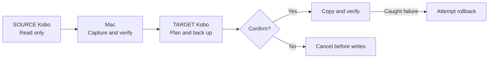

<h1 align="center">📚 Kobo KOReader Migration</h1>

<p align="center">
  <strong>Your books. Your reading progress. Your next Kobo.</strong><br/>
  Move KOReader, ebooks, reading data and custom fonts between Kobo readers using a Mac.<br/>
  Keep the original folder paths, preview changes and verify copied files.
</p>

<p align="center">
  <a href="https://github.com/gh-slee/kobo-koreader-migrate/actions/workflows/tests.yml?query=branch%3Amain"></a>
  <a href="#tech-stack"></a>
  <a href="#requirements"></a>
  <a href="#tech-stack"></a>
  <a href="LICENSE"></a>
  <a href="#project-status-and-roadmap"></a>
</p>

<p align="center">
  <a href="#quick-start">Quick start</a> ·
  <a href="#choose-a-mode">Modes</a> ·
  <a href="#tech-stack">Tech stack</a> ·
  <a href="#language-support">Languages</a> ·
  <a href="#contributing">Contribute</a> ·
  <a href="https://github.com/gh-slee/kobo-koreader-migrate/issues">Report a bug</a>
</p>

> [!IMPORTANT]
> **3.3.0-dev.1 is an experimental development build.** Automated fixture CI passes on macOS and Linux; physical-Kobo testing and human sign-off are still pending. Device migration requires **macOS**. Locale support currently covers help and static UI samples; migration/maintenance messages remain English.

## Why use it?

| | What you get |
| --- | --- |
| 📦 **Four migration modes** | Copy the entire supported setup, only KOReader, selected library content, or inspect without device writes. |
| 📂 **Original book locations** | `Books/Comics/issue.cbz` on SOURCE stays `Books/Comics/issue.cbz` on TARGET. EPUB, PDF, CBZ and other recognised formats follow the same rule. |
| 🔎 **A plan before changes** | Preview new, changed, identical and TARGET-only files. Size/SHA-256 comparisons skip identical payload files. |
| 🛟 **Backups and recovery** | Capture SOURCE, back up TARGET, verify copied bytes and attempt rollback on caught failures. Reuse saved SOURCE archives or restore a recorded TARGET snapshot. |
| 🧭 **Visible progress** | Phase timestamps, file/byte counts, transfer/hash speed, ETA and archive heartbeats show what the tool is doing. |
| 🔒 **Offline operation** | Python standard library plus macOS tools. No runtime downloads, telemetry, AI keys or LLM service. Private artifacts stay in local run folders. |

## Quick start

The complete development source is available on [`main`](https://github.com/gh-slee/kobo-koreader-migrate/tree/main). This is an experimental build; start with the offline checks and a dry run.

### 1. Get the project

```bash
git clone https://github.com/gh-slee/kobo-koreader-migrate.git
cd kobo-koreader-migrate
python3 --version
python3 scripts/check_locales.py
python3 kobo-koreader-migrate.py --self-test
```

Python 3.9+ is required. No `pip install` is needed. You can also select `main` on GitHub and choose **Code > Download ZIP**. Keep the complete `locales/` directory beside `kobo-koreader-migrate.py`; copying the script alone is not a complete installation, even for English.

### 2. Explore without a Kobo

```bash
python3 kobo-koreader-migrate.py --help
python3 kobo-koreader-migrate.py --list-locales
python3 kobo-koreader-migrate.py --locale zh-Hant --preview-ui
```

These help/list/preview commands do not inspect devices or existing run data and do not create migration logs/backups. The UI preview is a static sample, separate from device inspection with `--dry-run`.

### 3. Preview a migration

Disconnect both Kobos first. Quit KOReader normally before connecting either device, then follow the SOURCE/TARGET prompts one device at a time:

```bash
python3 kobo-koreader-migrate.py --mode full --dry-run
```

A dry run reads both devices and creates local reports/locks, but changes no Kobo files and creates no ZIP backups. Review the plan. When ready to migrate, rerun without `--dry-run`; the tool recalculates the plan and asks for final confirmation:

```bash
python3 kobo-koreader-migrate.py --mode full
```

> [!NOTE]
> FULL includes supported books, reading data and root fonts by default. It retains TARGET-only library files outside `.adds/koreader`, but replaces the **entire KOReader directory** after backup. See [complete mode behavior](docs/USAGE.md#choose-a-mode) before approving writes.

Do not run as `sudo`. Keep backups until you have checked the result on TARGET. Cloning main obtains current development source, not a version-pinned release. Release publication and physical-device acceptance remain separate steps.

## Requirements

- **macOS** with `ditto`, `diskutil` and `sync`; **Python 3.9+**. No third-party Python packages.
- Kobo USB storage, connected **one device at a time**, with readable `.kobo/version` identity data.
- Existing SOURCE KOReader installation for FULL/KOREADER and enough Mac/TARGET space for staging, backups and copying.
- The operator confirms each physical model and SOURCE-build compatibility with TARGET.

[Full compatibility requirements](docs/USAGE.md#requirements-and-compatibility). Windows/Linux device migration is unsupported; Linux CI validates fixtures only.

## Choose a mode

| Mode | KOReader runtime | Books and reading data outside runtime | Root fonts |
| --- | --- | --- | --- |
| **FULL** | Replace entire tree | Included, preserving original paths | Included by default |
| **KOREADER** | Replace entire tree | Not copied | Not copied |
| **LIBRARY** | Retain installed runtime | Selected with flags/prompts | Optional |
| **AUDIT** | Inspect and plan only | Inspect selected content | Inspect if selected |

FULL is the default interactive mode. It retains TARGET-only library files outside `.adds/koreader`, but replaces the **entire KOReader tree**, including TARGET-only content within it, after backup. Different matching payload files are backed up and replaced; identical files are skipped.

AUDIT and `--dry-run` make no Kobo writes, but create local reports/locks. [Complete modes and examples](docs/USAGE.md#choose-a-mode).

## How it works



SOURCE is ejected before TARGET is requested. Writes require final confirmation; caught failures attempt rollback while the original TARGET remains connected. [Step-by-step workflow](docs/USAGE.md#how-it-works) · [Recovery limits](docs/RECOVERY.md#recovery-boundaries).

## Tech stack

| Layer | Technology |
| --- | --- |
| 🐍 CLI | Python standard library, Python 3.9+ |
| 📦 Integrity | ZIP archives and SHA-256 manifests |
| 💾 macOS integration | `ditto`, `diskutil`, `sync`, OS-backed locks |
| 🌐 Records and locale data | UTF-8 JSON, read-only SQLite diagnostics |
| 🧪 Verification | `unittest`, synthetic fixtures, GitHub Actions |

[Implementation details and test commands](docs/DEVELOPMENT.md). GitHub CLI is optional maintainer tooling; the migration CLI has no network, telemetry or LLM runtime dependency.

## Language support

English (`en`), Traditional Chinese (`zh-Hant`) and Simplified Chinese (`zh-Hans`) are registered. Chinese help descriptions and static UI samples are available; **actual migration/maintenance output remains English**. Keep `locales/` beside the script, even for English.

[Language selection and fallback](docs/USAGE.md#language-support). Translation wording and full interface localization still need the planned review/implementation work.

## Documentation

| Audience | Guide |
| --- | --- |
| Start migrating | [User guide: modes, books, metadata, fonts and all flags](docs/USAGE.md) |
| Manage backups | [Saved sources, TARGET restore, run records and cleanup](docs/RECOVERY.md) |
| Resolve problems | [Troubleshooting, recovery guidance and exit codes](docs/TROUBLESHOOTING.md) |
| Contribute code | [Architecture, technology, tests and coding agents](docs/DEVELOPMENT.md) |
| Maintain the repository | [Privacy checks, PR helper and release preparation](docs/MAINTAINING.md) |
| Review the project | [Contributing](CONTRIBUTING.md) · [Security](SECURITY.md) · [Changelog](CHANGELOG.md) |
| Test planned behavior | [Manual acceptance](ACCEPTANCE.md) · [Roadmap](TRACKER.md) |

## Safety and privacy

- Discovery uses recognised extensions; it does not guarantee every ebook or DRM-managed item is found. [Formats and exclusions](docs/USAGE.md#book-discovery).
- Reading metadata is copied, **not merged**. Whole-runtime copying also copies SOURCE settings; selective hardware-setting preservation is not implemented.
- Backups/reports can contain credentials, identifiers, reading history and filenames. Keep `runs/` private and share only synthetic/redacted reproductions.
- `--cleanup` alone previews eligibility. Deletion needs explicit run IDs and typed confirmation; it is never scheduled automatically. [Cleanup rules](docs/RECOVERY.md#backup-cleanup).

## Project status and roadmap

**3.3.0-dev.1 is experimental.** CI uses temporary fixtures; successful checks do not prove physical-device compatibility. Human testing/sign-off remains pending. The badge tracks push CI on main.

Interrupted-transfer resume, exact library mirroring, content-assisted discovery, portable hardware settings and full migration-interface translations remain planned work. [Current status and criteria](TRACKER.md) · [Automated evidence](docs/DEVELOPMENT.md#validation-and-release-status).

## Contributing

Focused fixes, documentation improvements, synthetic regressions and locale-preview feedback are welcome. Read [CONTRIBUTING.md](CONTRIBUTING.md); coding agents use the shared [AGENTS.md](AGENTS.md) open format. AI-assisted contributions remain the contributor's responsibility, and all runtime features must remain standalone offline code.

Report reproducible bugs and feature requests through [GitHub Issues](https://github.com/gh-slee/kobo-koreader-migrate/issues). Follow [SECURITY.md](SECURITY.md) for sensitive findings; never attach books, raw backups or unredacted device data.

## Acknowledgments and license

Built for readers using [KOReader](https://github.com/koreader/koreader) on Kobo devices. Thanks to the KOReader community and this project's [contributors](https://github.com/gh-slee/kobo-koreader-migrate/graphs/contributors).

This tool is under the [MIT License](LICENSE). Device software, plugins, fonts and books retain their own licences. This is an independent community tool, not an official Kobo or KOReader project.
